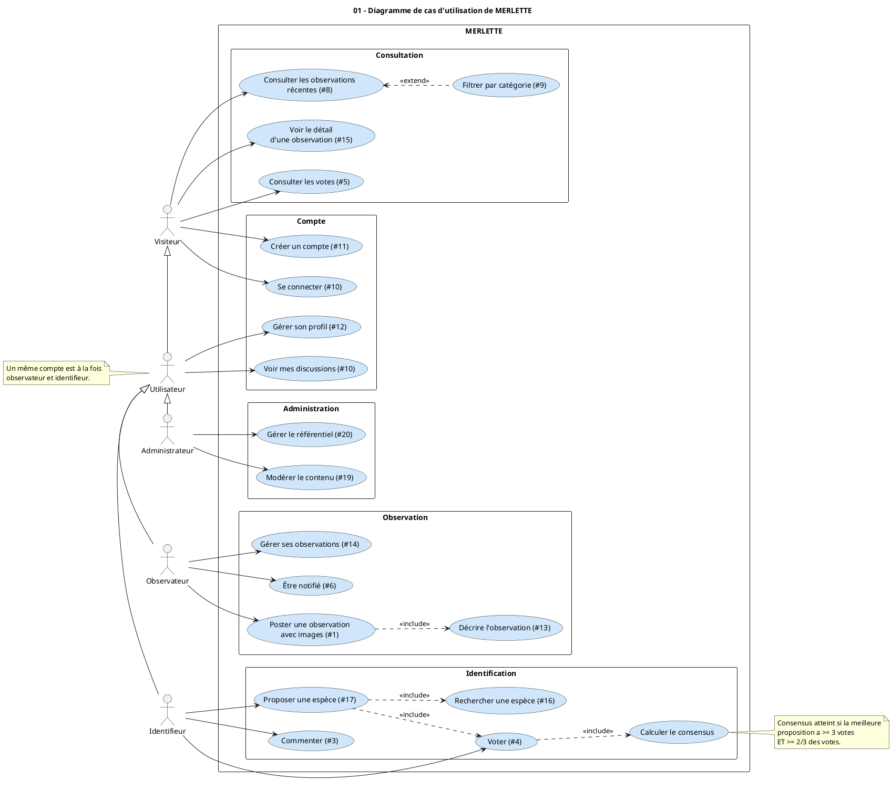
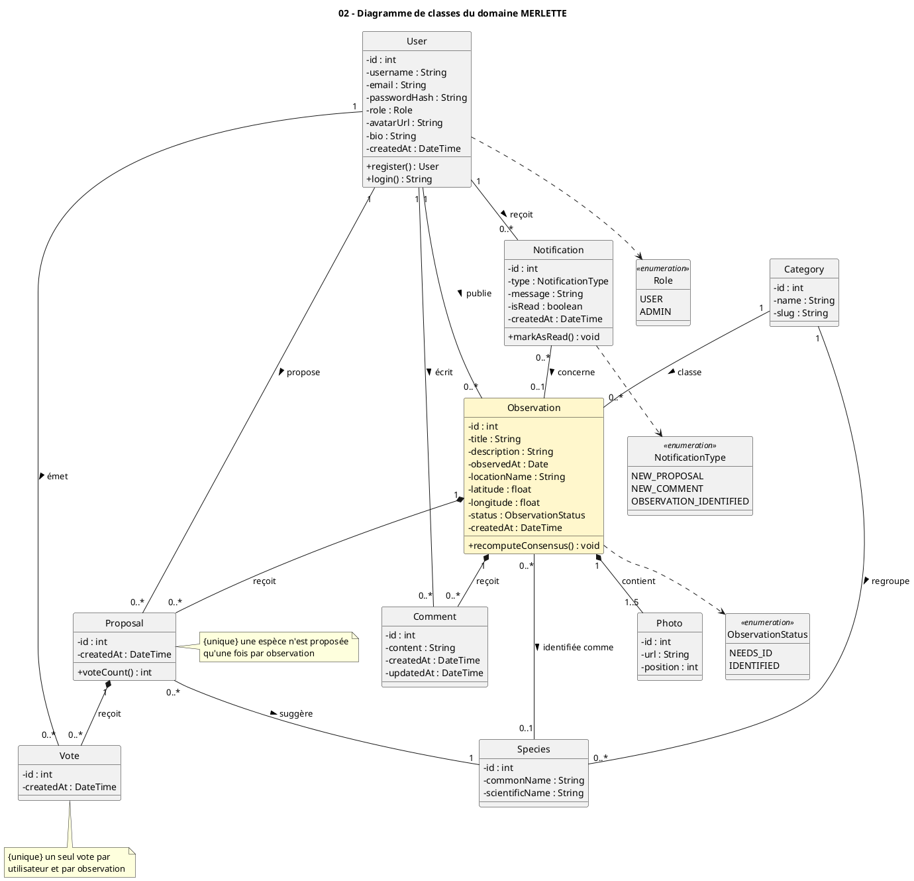
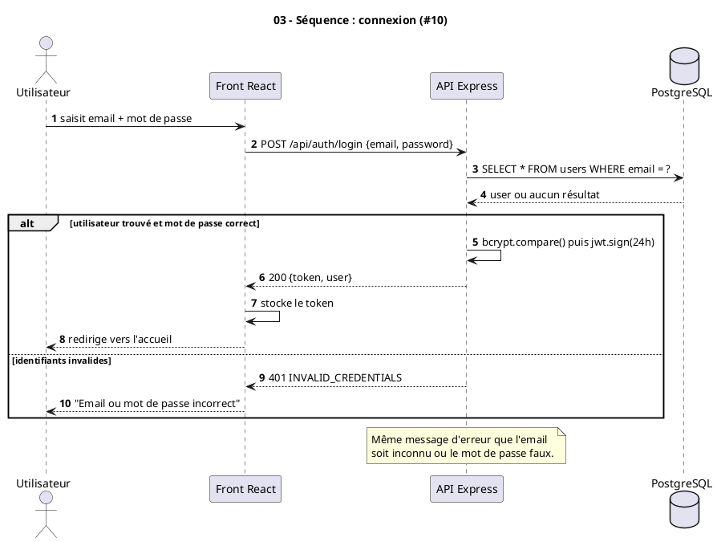
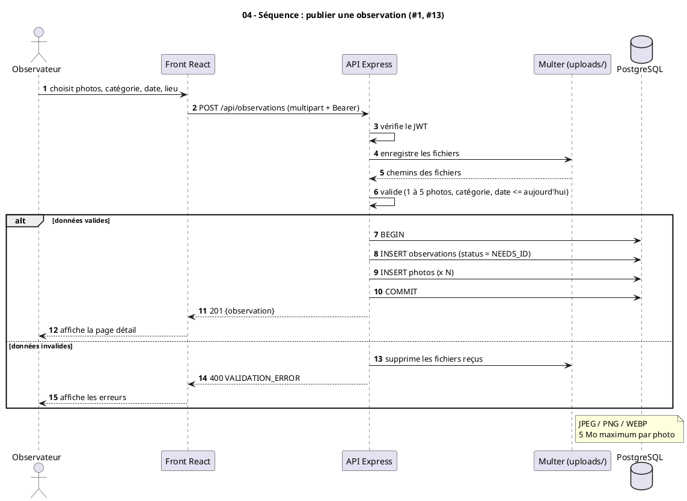
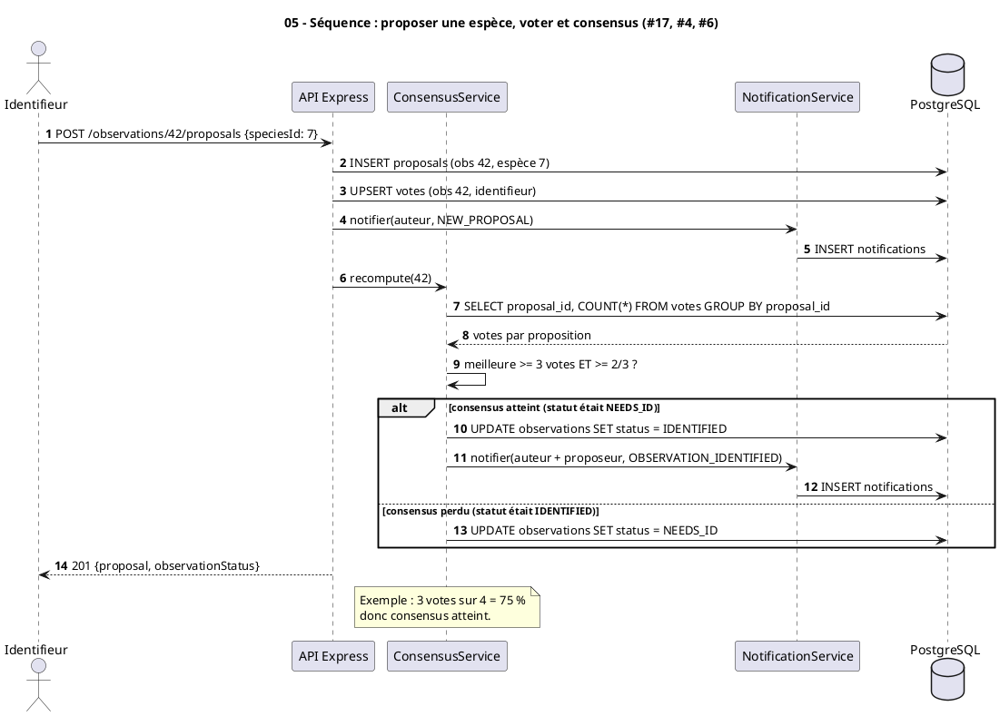
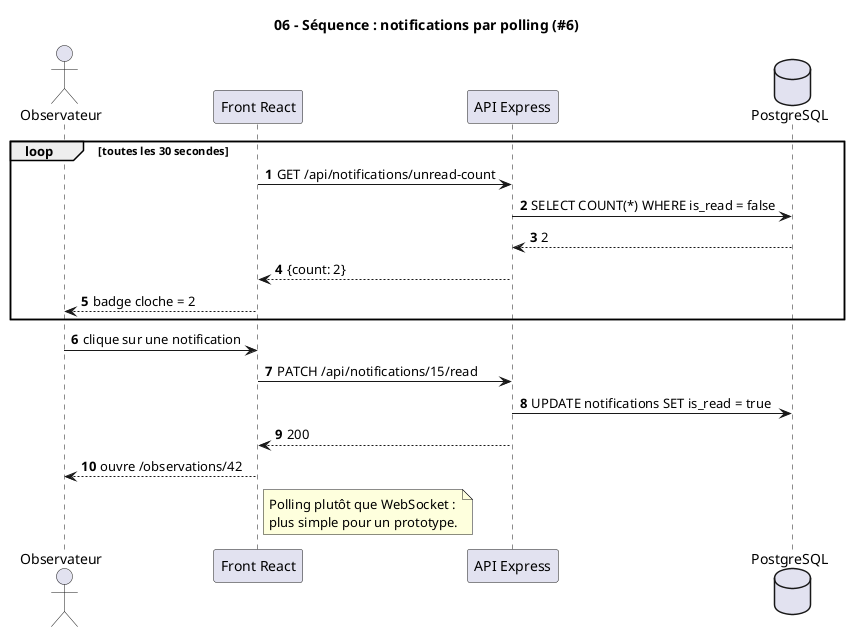
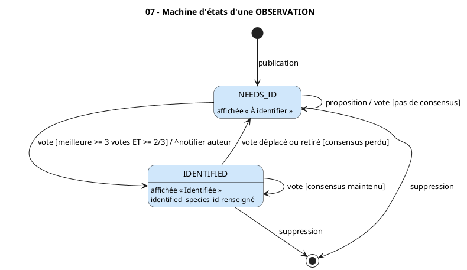
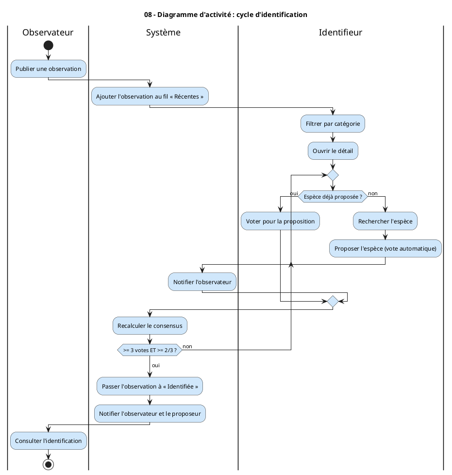
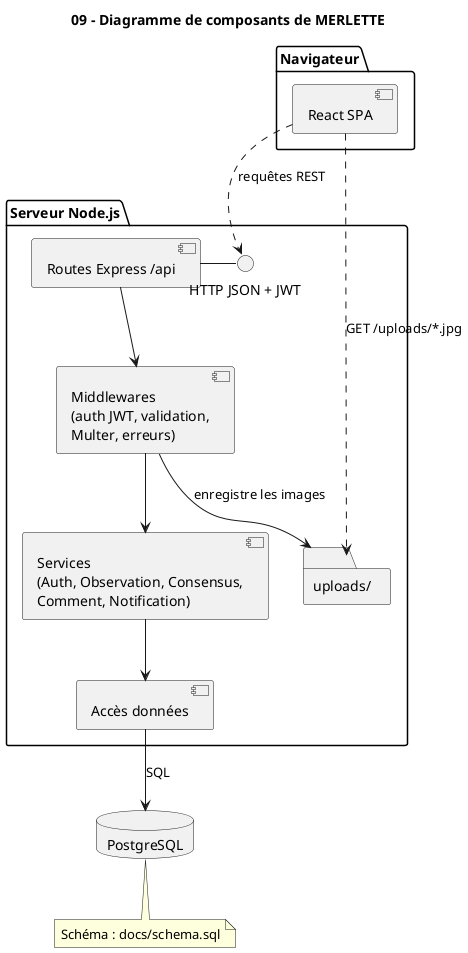
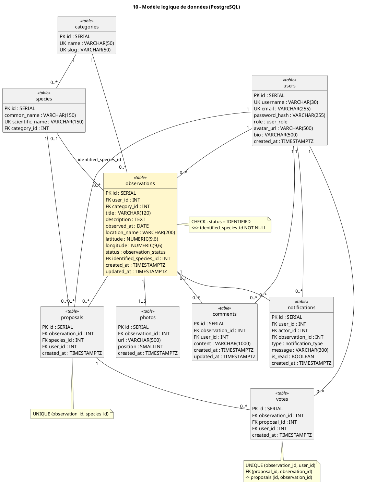

# Merlette — Diagrammes UML

Les diagrammes sont écrits en **PlantUML** et rendus en PNG.

| Dossier | Contenu |
|---|---|
| [`visual_paradigm/`](visual_paradigm/) | Sources `.puml`, importables dans Visual Paradigm (*Project → Import → PlantUML… → Import Multiple Diagrams from Folder*) |
| [`diagrams/`](diagrams/) | Images PNG générées, insérées ci-dessous |

Régénérer les images après une modification :

```bash
java -jar ~/.config/VisualParadigm/plugins/plugin-plantuml-vp-v1.0.0/lib/plantuml.jar \
     -charset UTF-8 -tpng -o ../diagrams docs/visual_paradigm/*.puml
```

| # | Diagramme | Type UML | Fichier |
|---|---|---|---|
| 01 | Cas d'utilisation | Cas d'utilisation | `mer_01_cas_utilisation` |
| 02 | Classes du domaine | Classes | `mer_02_classes_domaine` |
| 03 | Connexion | Séquence | `mer_03_seq_connexion` |
| 04 | Publier une observation | Séquence | `mer_04_seq_publier_observation` |
| 05 | Proposer, voter, consensus | Séquence | `mer_05_seq_vote_consensus` |
| 06 | Notifications | Séquence | `mer_06_seq_notifications` |
| 07 | Cycle de vie d'une observation | Machine d'états | `mer_07_etats_observation` |
| 08 | Cycle d'identification | Activité | `mer_08_activite_identification` |
| 09 | Architecture | Composants | `mer_09_composants` |
| 10 | Modèle logique de données | Classes (tables) | `mer_10_mld_base_donnees` |

---

## 01 — Diagramme de cas d'utilisation



Source : [`mer_01_cas_utilisation.puml`](visual_paradigm/mer_01_cas_utilisation.puml)

**Lecture**
- **Acteurs et héritage** : l'*Utilisateur* hérite du *Visiteur* (il peut tout ce que fait un visiteur). *Observateur*, *Identifieur* et *Administrateur* héritent de l'*Utilisateur*. Observateur et identifieur sont deux rôles d'un même compte, pas deux types de comptes.
- **Regroupement** : les cas sont rangés par epic (Consultation, Compte, Observation, Identification, Administration), comme dans les user stories.
- **`<<include>>`** : poster une observation inclut toujours sa description (#13) ; proposer une espèce inclut toujours la recherche (#16) et un vote (#4) ; chaque vote déclenche le calcul du consensus.
- **`<<extend>>`** : le filtre par catégorie (#9) est une extension facultative de la consultation des observations récentes (#8).

---

## 02 — Diagramme de classes du domaine



Source : [`mer_02_classes_domaine.puml`](visual_paradigm/mer_02_classes_domaine.puml)

**Lecture**
- **`Observation`** (en jaune) est la classe centrale : elle **compose** ses photos (1 à 5), propositions et commentaires. Supprimer une observation les supprime aussi (losange plein).
- **`Proposal`** relie une observation à une `Species` suggérée ; **`Vote`** est composé par la proposition qu'il soutient.
- L'association *identifiée comme* (0..1) vers `Species` n'est renseignée que lorsque le consensus est atteint.
- **Contraintes** (notes) : un seul vote par utilisateur et par observation ; une espèce n'est proposée qu'une fois par observation.
- Les trois énumérations (`Role`, `ObservationStatus`, `NotificationType`) sont reliées par une dépendance aux classes qui les utilisent.

---

## 03 — Séquence : connexion (#10)



Source : [`mer_03_seq_connexion.puml`](visual_paradigm/mer_03_seq_connexion.puml)

**Lecture**
- Le mot de passe est vérifié avec `bcrypt.compare`, puis l'API signe un JWT valable 24 h que le front stocke.
- Le fragment **`alt`** montre les deux issues. En cas d'échec, le message est le même que l'email soit inconnu ou le mot de passe faux, pour ne pas révéler quels comptes existent.

---

## 04 — Séquence : publier une observation (#1, #13)



Source : [`mer_04_seq_publier_observation.puml`](visual_paradigm/mer_04_seq_publier_observation.puml)

**Lecture**
- Multer enregistre d'abord les fichiers, puis l'API valide l'ensemble (1 à 5 photos, catégorie, date non future).
- L'observation et ses photos sont insérées dans **une seule transaction** (`BEGIN … COMMIT`) : soit tout est créé, soit rien.
- Si la validation échoue, les fichiers déjà reçus sont supprimés pour ne pas laisser d'images orphelines.

---

## 05 — Séquence : proposer une espèce, voter et consensus (#17, #4, #6)



Source : [`mer_05_seq_vote_consensus.puml`](visual_paradigm/mer_05_seq_vote_consensus.puml)

**Lecture**
- Proposer une espèce crée la proposition **et** place le vote du proposeur dessus (`UPSERT` : s'il avait déjà voté ailleurs, son vote est déplacé).
- `ConsensusService` recompte les votes après chaque changement. Règle : la meilleure proposition doit avoir **au moins 3 votes et au moins 2/3 des votes**.
- Le fragment **`alt`** couvre les deux changements d'état possibles : consensus atteint (notification à l'auteur et au proposeur) ou consensus perdu (retour à `NEEDS_ID`).

---

## 06 — Séquence : notifications par polling (#6)



Source : [`mer_06_seq_notifications.puml`](visual_paradigm/mer_06_seq_notifications.puml)

**Lecture**
- Le fragment **`loop`** représente l'appel répété toutes les 30 s pour mettre à jour le badge de la cloche.
- Cliquer sur une notification la marque comme lue puis ouvre l'observation concernée.
- Le polling a été préféré aux WebSockets pour garder le prototype simple.

---

## 07 — Machine d'états d'une observation



Source : [`mer_07_etats_observation.puml`](visual_paradigm/mer_07_etats_observation.puml)

**Lecture**
- Une observation naît dans l'état **`NEEDS_ID`** (« À identifier »).
- Transitions au format `événement [garde] / action` : un vote qui fait atteindre le consensus la fait passer à **`IDENTIFIED`** et notifie l'auteur (`^notifier auteur`).
- L'état n'est pas définitif : si des votes sont déplacés ou retirés et que le consensus est perdu, elle revient à `NEEDS_ID`.
- La suppression est possible depuis les deux états.

---

## 08 — Diagramme d'activité : cycle d'identification



Source : [`mer_08_activite_identification.puml`](visual_paradigm/mer_08_activite_identification.puml)

**Lecture**
- Trois **couloirs** (swimlanes) : Observateur, Système, Identifieur.
- La décision *Espèce déjà proposée ?* oriente l'identifieur soit vers un vote, soit vers une nouvelle proposition (qui notifie l'observateur).
- La **boucle** se répète tant que la règle de consensus n'est pas satisfaite ; à la sortie, l'observation est marquée « Identifiée » et les personnes concernées sont notifiées.

---

## 09 — Diagramme de composants



Source : [`mer_09_composants.puml`](visual_paradigm/mer_09_composants.puml)

**Lecture**
- Le **front React** dialogue avec l'API uniquement via l'interface **HTTP JSON + JWT**, et charge les images directement depuis le dossier `uploads/`.
- Côté serveur, chaque requête traverse les couches dans l'ordre : routes → middlewares → services → accès données → PostgreSQL.
- La règle de consensus et les notifications vivent dans la couche **Services**, ce qui permet de les tester indépendamment des routes.

---

## 10 — Modèle logique de données



Source : [`mer_10_mld_base_donnees.puml`](visual_paradigm/mer_10_mld_base_donnees.puml)

**Lecture**
- Chaque classe `<<table>>` correspond à une table de [`schema.sql`](schema.sql) ; `PK` = clé primaire, `FK` = clé étrangère, `UK` = valeur unique.
- Les notes indiquent les contraintes qui portent les règles métier directement en base :
  - `votes` : `UNIQUE (observation_id, user_id)` garantit un seul vote par utilisateur et par observation, et la clé étrangère composite garantit que le vote vise une proposition de la **même** observation ;
  - `proposals` : `UNIQUE (observation_id, species_id)` ;
  - `observations` : `CHECK` qui impose une espèce retenue si et seulement si le statut est `IDENTIFIED`.
- Le détail de chaque colonne est dans [`04-database.md`](04-database.md).
